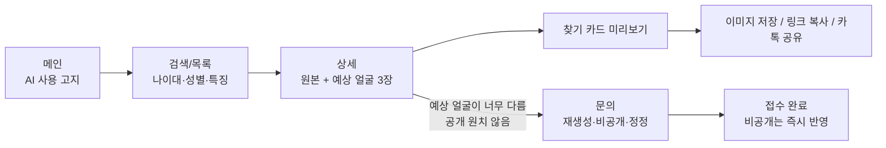
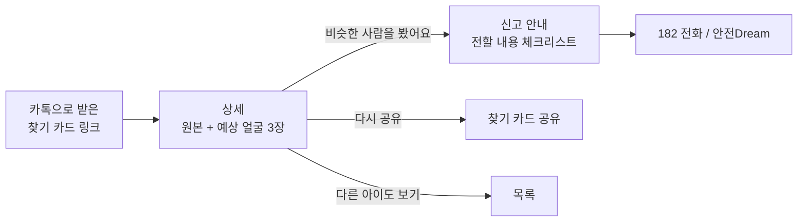
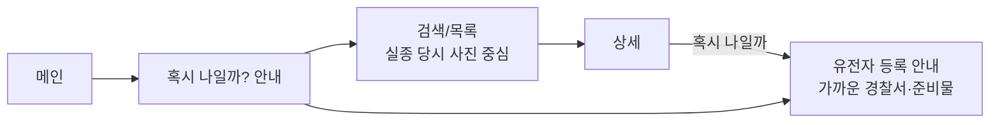

# FindUs 사용자 플로우 & 메뉴 구조 (초안)

> 담당: 황호태 · 작성일: 2026.10.08
> 기준 문서: `01_기획서/FindUs_기획서_v2_멘토링반영.docx` (4장 이용 흐름, 7장 MVP, 8-2 주요 화면)
> ⚠ v2의 "팀 확인이 필요한 결정"(주 이용자 = 가족, 지도 제외 등)이 확정됐다는 전제로 작성했습니다.

---

## 0. 작업 방법 (이 순서로 진행)

| 단계 | 할 일 | 결과물 |
| --- | --- | --- |
| 1 | 이용자별 **목표**와 **들어오는 경로(진입점)** 정리 | 1장 표 |
| 2 | 이용자별 **태스크 플로우** 그리기 (진입 → 목표 달성까지, 화면 단위) | 2장 플로우 |
| 3 | 플로우에 나온 화면을 모아 **화면 목록** 만들기 (중복 제거, ID 부여) | 3장 화면 목록 |
| 4 | 화면을 묶어 **메뉴 구조(IA)** 설계 (메뉴 깊이 2단계 이내) | 4장 메뉴 트리 |
| 5 | **예외 흐름** 추가 (검색 0건, 공개 종료, 예상 얼굴 없음, 오류) | 5장 |
| 6 | **기획서와 대조**해 빠진 화면·충돌 찾기 → 팀 안건으로 올리기 | 6장 |
| 7 | FigJam으로 옮겨 그리고, 팀원과 이용자별로 한 번씩 따라가 보기(워크스루) | FigJam 보드 |

**확인할 때 기준 (워크스루 체크리스트)**
- [ ] 이용자별 목표까지 **3번 이하 탭**으로 가는가? (시민: 카드 → 상세 → 182)
- [ ] 막다른 화면이 없는가? (모든 화면에 다음 행동 또는 돌아가기가 있는가)
- [ ] 예상 얼굴이 원본 없이 혼자 보이는 화면이 없는가?
- [ ] 모든 화면에 AI 표시·출처 표기가 있는가?
- [ ] 제보 내용·위치·사진을 입력받는 화면이 없는가? (v2: 제보는 182로만)
- [ ] 퍼센트·확률 표시가 없는가?

---

## 1. 이용자와 진입점

| 이용자 | 목표 | 주로 들어오는 경로 | 첫 화면 |
| --- | --- | --- | --- |
| **가족·보호자** (주) | 우리 아이의 예상 얼굴 확인 → 찾기 카드로 홍보 / 필요 시 재생성·비공개 요청 | 검색 포털, 기관·가족 단체 안내 | 메인 → 검색 |
| **시민** (보조) | 공유받은 아이를 기억 → 비슷한 사람을 보면 182 신고 | **카톡·SNS로 받은 찾기 카드 링크** | 공유 링크 랜딩(상세) |
| **본인일 수 있는 사람** (보조) | "혹시 나일까" 확인 → 유전자 등록 방법 알기 | 검색 포털, 입양인 커뮤니티 | 메인 → "혹시 나일까?" |
| 서비스(시스템) | 매일 새벽 동기화, 예상 얼굴 3장 생성, 발견 사건 비공개 | — | — |

> 핵심: 시민은 메인으로 오지 않고 **공유 링크로 바로 상세에 떨어진다.** 그래서 상세 화면 하나만 봐도 신고까지 갈 수 있어야 함.

---

## 2. 이용자별 태스크 플로우

### 2-1. 가족·보호자



### 2-2. 시민 (공유받은 경우 — 가장 많은 경로)



### 2-3. 본인일 수 있는 사람



---

## 3. 화면 목록 (MVP)

| ID | 화면 | 주요 요소 | 이동 |
| --- | --- | --- | --- |
| S01 | 메인 | AI 사용 고지, 검색창, 실종아동 목록(원본+예상 얼굴 썸네일), "혹시 나일까?" 진입 배너 | S02, S03, S05 |
| S02 | 검색 결과/목록 | 현재 나이대·성별·신체 특징 필터, 페이지네이션, 지역 필터 없음 | S03 |
| S03 | 상세 | 원본(크게) + 예상 얼굴 3장, AI 안내, 당시/현재 나이·착의·특징, 출처 / 버튼: 찾기 카드 공유 · 비슷한 사람을 봤어요 · 혹시 나일까 · 정보 수정·비공개 요청 | S03-1, S04, S05, S06 |
| S03-1 | 찾기 카드 공유 (바텀시트) | 카드 미리보기(AI 표시·출처·182 포함), 이미지 저장·링크 복사·카톡 | S03 |
| S04 | 신고 안내 | 182에 전할 내용 체크리스트(일시·장소·인상착의·동행인·상황), 182 전화, 안전Dream 바로가기, "FindUs는 제보를 받지 않아요" | 외부 |
| S05 | 혹시 나일까? (유전자 등록 안내) | 대상 설명, 유전자 등록 절차·준비물, 가까운 경찰서 안내, (확장) 다국어 | S02, 외부 |
| S06 | 문의 | 요청 유형(비공개/재생성/정정), 대상 사건(상세에서 오면 자동 입력), 관계, 연락받을 이메일, 내용 | S06-1 |
| S06-1 | 문의 접수 완료 | 처리 안내(비공개는 즉시), 원본 정보 정정은 안전Dream·182 안내 | S01 |
| S07 | 서비스 소개 / AI 안내 | AI 예상 얼굴이 무엇이고 한계는 무엇인지, 데이터 출처, 개인정보 처리 | — |
| S00 | 공통 상태 | 로딩, 검색 0건, 오류, **공개 종료**, **예상 얼굴 없음** | — |

---

## 4. 메뉴 구조 (IA)

```
FindUs
├─ 실종아동 찾기 (S01 메인 → S02 목록/검색)
│   └─ 상세 (S03)
│       ├─ 찾기 카드 공유 (S03-1)
│       ├─ 비슷한 사람을 봤어요 → 신고 안내 (S04)
│       ├─ 혹시 나일까 → 유전자 등록 안내 (S05)
│       └─ 정보 수정·비공개 요청 → 문의 (S06, 사건 자동 입력)
├─ 신고 안내 (S04)
├─ 혹시 나일까? (S05)
├─ 서비스 소개 (S07)  ※ AI 예상 얼굴 안내 포함
└─ [푸터] 문의(S06) · 개인정보처리방침 · [자료 출처: 경찰청]
```

**배치 (모바일 웹 기준)**
- **상단 헤더:** 로고(→ 메인) + 검색 아이콘 + 햄버거 메뉴
- **햄버거 메뉴(1단계 4개):** 실종아동 찾기 / 신고 안내 / 혹시 나일까? / 서비스 소개
- **문의는 메뉴에 올리지 않음:** 상세 화면 하단 "정보 수정·비공개 요청"과 푸터에서만 진입 → 시민의 잘못된 문의를 줄이고, 사건이 자동으로 지정됨
- **상세 화면 하단 고정 버튼:** [찾기 카드 공유] [비슷한 사람을 봤어요] — 시민의 핵심 행동 2개
- **182 전화**는 신고 안내 화면에만 크게, 다른 화면은 푸터에 작게 (오신고 방지)
- 데스크톱: 햄버거 대신 상단 가로 메뉴로 펼침

---

## 5. 예외 흐름

| 상황 | 처리 |
| --- | --- |
| 검색 결과 0건 | "조건에 맞는 결과가 없어요" + 필터 초기화 |
| 공유 링크의 사건이 비공개·발견됨 | 사진·정보 없이 "공개가 종료된 정보입니다" + 다른 실종아동 보기 |
| 예상 얼굴 미생성 (나이 차 기준 미달 / 얼굴 검출 실패) | 원본만 표시 + "이 사진은 예상 얼굴을 만들지 않았어요" 안내 (빈칸으로 두지 않음) |
| 비공개 요청 접수 직후 | 즉시 비공개 → 관리자 확인 후 유지/복구 |
| API·서버 오류 | "정보를 불러오지 못했어요" + 다시 시도 (마지막 동기화 시각 표시) |

---

## 6. 기획서 v2 대조 결과 — 팀 안건

1. **공유 링크 랜딩이 화면 목록에 없음** — 흐름 4번(시민이 공유받은 카드로 진입)이 있는데 8-2 화면 목록에 없음. → 상세(S03)를 링크로 바로 열리게 하자고 제안
2. **신고 안내와 유전자 등록 안내가 한 화면(③)에 묶여 있음** — 시민(목격 신고)과 본인(혹시 나일까)은 목적이 다름. → S04 / S05로 나누는 안 제안
3. **"본인일 수 있는 사람"의 진입점이 없음** — 메인에 "혹시 나일까?" 진입 배너가 필요한지
4. **문의 진입 위치와 입력 항목 미정** — 사칭 리스크(v2 리스크 항목)를 고려해 상세에서만 진입 + 사건 자동 지정 제안. 연락처를 받을지(이메일 1개) 결정 필요
5. **공개 종료 / 예상 얼굴 미생성 화면이 v2에 없음** — 동기화 규칙과 생성 조건에서 생기는 상태라 화면 정의 필요
6. **찾기 카드: 별도 화면 vs 상세 안 바텀시트** — 바텀시트 제안 (이동 단계 감소)
7. **`04_디자인/화면_프롬프트.md`는 v1 기준** — 제보 폼·지도·예상 얼굴 1장 기준이라 v2(제보 입력 없음, 예상 얼굴 3장, 찾기 카드, 문의, 유전자 안내)에 맞게 다시 써야 함
