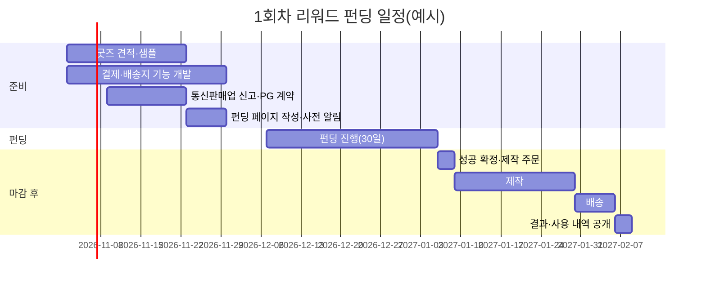
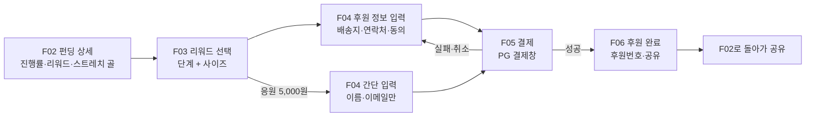
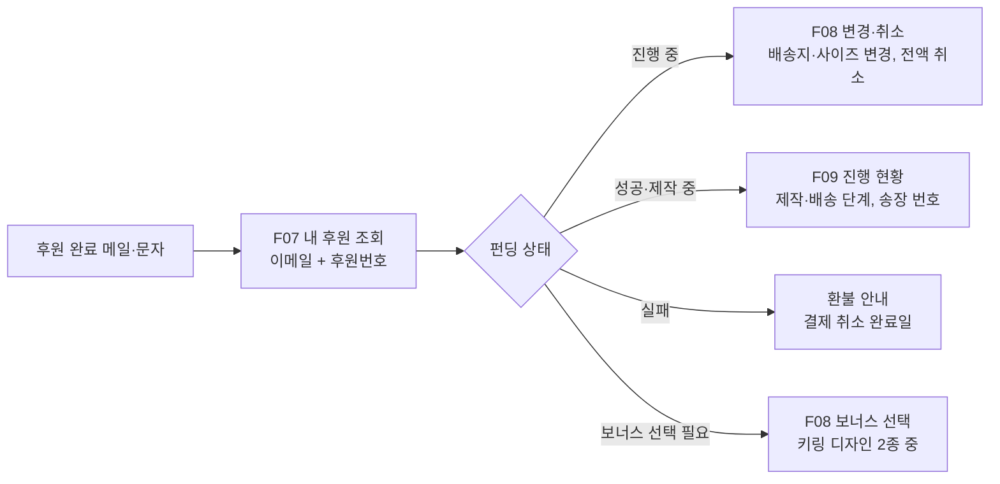
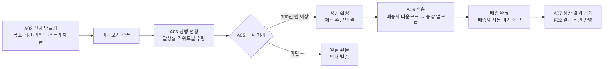

# FindUs 리워드 펀딩: 계획 & 화면 흐름

> 작성일: 2026.10.22
> 기준 문서: `01_기획서/BM_수익추정_스폰서십_펀딩.md` 2장, `01_기획서/FindUs_펀딩_기업후원_계획.pptx`, `04_디자인/사용자플로우_메뉴구조.md`
> 표기: **[가정]** = 견적·팀 결정 전 임시 값 · **[결정 필요]** = 팀 회의 안건
> 이 문서의 화면 ID(F = 후원자, A = 관리자)는 기존 화면 목록(S01~S07)과 겹치지 않게 붙였습니다.

---

## 0. 한 줄 요약

**텀블벅처럼 금액별 굿즈 세트를 고르고 배송지를 입력해 FindUs 사이트에서 직접 후원한다. 300만 원이 넘으면 제작해서 보내고, 넘지 못하면 전액 환불한다. 많이 모일수록 모든 후원자에게 보너스가 열린다.**

---

## 1. 펀딩 아이디어

### 1-1. 왜 하나

| 목적 | 설명 |
|---|---|
| 후원자 모으기 | 굿즈를 받은 사람이 FindUs를 기억하고, 다음 펀딩·정기후원으로 이어짐 |
| 길거리 홍보 | 키링·에코백·옷의 QR이 몇 년 동안 길에서 노출됨 |
| 기업 영업 실적 | "후원자 ○명, QR 스캔 ○회"라는 숫자를 기업 제안서에 씀 |
| 운영비 일부 | 2,000만 원이 모이면 약 670만 원이 남음 (매출 비중은 작음. 꾸준한 운영비는 기업 후원에서 나옴) |

### 1-2. 원칙

1. **기부금이 아니라 리워드(상품) 거래**로 운영합니다. 기부금을 그대로 받는 모금은 하지 않습니다(1천만 원 이상 등록 의무 · 모집비용 15% 상한).
2. **굿즈에는 아이 얼굴을 넣지 않고 QR만 넣습니다.** 옷에 인쇄한 사진은 아이가 발견돼도 회수할 수 없고, 가족 동의·초상권 문제가 생깁니다. QR은 항상 최신 목록으로 연결됩니다.
3. **목표를 못 채우면 전액 환불합니다.** 이 규칙은 펀딩 페이지 맨 위에 적어 둡니다.
4. **개인정보는 배송에 필요한 만큼만** 받고, 배송이 끝나면 파기합니다.
5. **결제는 FindUs 사이트에서 직접** 받습니다. 텀블벅(약 13%) 대신 카드 수수료(약 3.7%)만 내서, 후원자 500명이면 회차당 약 120만 원을 아낍니다.

### 1-3. 리워드 단계 (내가 얼마 후원하면)

| 단계 | 금액 | 구성 | 옵션 | 1명당 남는 금액 |
|---|---|---|---|---|
| 응원 | 5,000원 | 후원자 벽에 이름 + 디지털 감사 카드 (배송 없음) | 이름 공개 여부 | 4,813원 |
| QR 키링 | 15,000원 | 아크릴 키링(QR 각인) + QR 스티커 + 안내 카드 | — | 8,439원 |
| 에코백 세트 | 29,000원 | 키링 구성 + 캔버스 에코백(QR 인쇄) | — | 19,085원 |
| 티셔츠 세트 | 49,000원 | 에코백 세트 + 고중량 면 티셔츠(등판 반사 QR) | 사이즈 | 26,137원 |
| 후드 세트 | 89,000원 | 에코백 세트 + 기모 후드(자수 로고 + 반사 QR) | 사이즈 | 44,141원 |
| 패밀리 세트 | 149,000원 | 후드 1 + 티셔츠 2 + 키링 3 + 에코백 + 한정 넘버링 카드 | 사이즈 3개 | 74,097원 |
| 기업 단체 세트 | 별도 견적 | 50세트부터, 임직원 프로그램과 묶어 제안 | — | — |

- 단가 가정: 키링 1,500원 · 에코백 2,530원 · 티셔츠 12,000원 · 후드 32,000원 · 배송 3,500원 · 카드 수수료 3.4% + VAT **[가정, 견적으로 교체]**
- 단계별 후원자 비율 가정: 응원 15% · 키링 30% · 에코백 25% · 티셔츠 18% · 후드 9% · 패밀리 3% → 1인 평균 33,800원 **[가정]**
- 한 사람이 여러 단계를 담는 "장바구니"는 만들지 않습니다. 한 번에 한 단계만 고르고, 더 원하면 한 번 더 후원합니다. (화면과 정산이 단순해짐) **[결정 필요]**

### 1-4. 스트레치 골 (다 같이 얼마 모이면)

| 모인 금액 | 열리는 것 | 추가 비용 |
|---|---|---|
| 300만 원 | **펀딩 성공**: 각자 고른 세트 제작 시작 | — |
| 500만 원 | 키링 디자인 2종 중 선택 | 디자인·금형 약 30만 원 |
| 1,000만 원 | 키링 세트 후원자에게도 에코백 무료 추가 | 해당 후원자 1명당 약 2,800원 |
| 2,000만 원 | 모든 배송 세트에 엽서·스티커팩 | 1명당 약 800원 |
| 3,000만 원 | 5월 25일 실종아동의 날 캠페인 개최, 후원자 초대 | 약 200만 원 |

- 키링 디자인 2종처럼 **후원자가 고를 것이 생기는 보너스**는, 500만 원을 넘는 순간 기존 후원자에게도 선택 링크를 보내야 합니다(화면 F08).
- 보너스 비용을 넣어 계산해도 각 단계에서 손해가 나지 않습니다.

### 1-5. 목표 · 환불 규칙

| 항목 | 내용 |
|---|---|
| 최소 목표 | **300만 원** (후원자 약 90명). 고정비가 약 100만 원이라 약 250만 원부터 손해가 없음 |
| 펀딩 기간 | 30일 **[가정]** |
| 결제 시점 | **후원할 때 바로 결제 → 실패하면 전액 결제 취소** 를 추천. 텀블벅처럼 마감 때 결제하는 "예약 결제"는 PG의 자동결제(빌링) 계약이 따로 필요 **[결정 필요]** |
| 실패 시 | 마감 다음 날 일괄 결제 취소, 이메일·문자로 안내 |
| 성공 후 단순 변심 취소 | 마감 전까지는 자유롭게 취소. 마감 후에는 제작에 들어가므로, 주문 제작 예외를 적용하려면 **결제 전에 따로 알리고 동의를 받아야 함** |
| 불량·오배송 | 교환 또는 환불 |

### 1-6. 수익 시나리오 (1회차)

| 모인 금액 | 후원자 | 순익 | 절반 기부 후 운영비 |
|---|---|---|---|
| 300만 원 | 약 90명 | 21만 원 | 11만 원 |
| 500만 원 | 약 150명 | 72만 원 | 36만 원 |
| 1,000만 원 | 약 300명 | 250만 원 | 125만 원 |
| 2,000만 원 | 약 590명 | 669만 원 | 335만 원 |
| 3,000만 원 | 약 890명 | 869만 원 | 435만 원 |

비용 = 제작·포장·배송·결제 수수료 + 고정비 약 100만 원 + 여유 생산 5% + 광고비 10% + 스트레치 골 보너스 + (1,500만 원 미만일 때) 소량 인쇄 추가 단가

### 1-7. 기업과 묶는 방법 (선택)

| 방식 | 내용 | 화면에 보이는 곳 |
|---|---|---|
| 펀딩 회차 스폰서 | 기업이 회차당 약 500만 원 **[가정]** 을 내고, 고정비와 스트레치 골 비용을 부담 | 펀딩 상세 하단 "이번 펀딩은 ○○와 함께합니다", 굿즈 안내 카드의 작은 로고 |
| 스트레치 골 후원 | "1,000만 원 돌파 시 에코백 추가 (○○ 후원)" | 스트레치 골 목록 |
| 매칭 후원 | 시민이 모은 금액만큼 기업이 추가로 냄 (최대 ○○만 원) | 진행률 바 옆 "○○ 매칭 +○○만 원" |
| 기업 단체 세트 | 임직원용 50세트 이상 | 펀딩 상세 하단 "기업 단체 후원 문의" |

> 아이 정보 바로 옆에는 기업 광고를 두지 않습니다. 로고와 "함께합니다" 한 줄만 넣습니다.

### 1-8. 1회차 일정 [가정]



- 마감 후 받기까지 약 4~6주
- 실종아동의 날(5월 25일)에 맞춰 2회차를 열면 홍보 효과가 큼 **[결정 필요]**

---

## 2. 후원자 화면 흐름

### 2-1. 들어오는 길

| 진입점 | 첫 화면 | 비고 |
|---|---|---|
| 메인 배너 "함께 찾기 펀딩 진행 중" | F02 펀딩 상세 | 펀딩 기간에만 노출 |
| 실종아동 상세(S03) 하단 "FindUs를 응원하기" | F02 펀딩 상세 | 아이 정보 화면에는 작은 링크 한 줄만 |
| SNS·카톡 공유 링크 | F02 펀딩 상세 | 공유 미리보기 이미지에 진행률 표시 |
| 굿즈 · 택배의 QR | F10 QR 랜딩 | 펀딩이 아니라 **실종아동 목록**으로 연결 |
| 후원 완료 메일의 링크 | F07 내 후원 조회 | 로그인 없이 이메일 + 후원번호 |

### 2-2. 후원하기 (가장 중요한 흐름)



- 목표: **F02에서 결제 완료까지 4단계 안에** 끝내기
- 응원(5,000원)은 배송이 없으므로 배송지 입력을 건너뜀

### 2-3. 후원 후 (조회 · 변경 · 취소)



### 2-4. 펀딩 상태에 따라 바뀌는 화면

| 상태 | F02 펀딩 상세에 보이는 것 | 버튼 |
|---|---|---|
| 오픈 예정 | 오픈일, 리워드 미리보기 | [오픈 알림 받기] |
| 진행 중 | 진행률 바, 남은 기간, 다음 스트레치 골까지 남은 금액 | [후원하기] |
| 마감 임박(3일 이내) | 위와 같음 + "D-3" 강조 | [후원하기] |
| 성공 | "○○○명이 함께해 ○○○만 원을 모았어요", 제작·배송 일정 | [내 후원 조회] |
| 실패 | "목표에 닿지 못해 전액 환불했어요", 환불 완료일 | [내 후원 조회] [다음 펀딩 알림 받기] |
| 결과 공개 | 모인 금액, 제작비·배송비·수수료·기부 금액, 사진 | [다음 펀딩 알림 받기] |

### 2-5. 화면 목록

| ID | 화면 | 주요 요소 | 이동 |
|---|---|---|---|
| F01 | 펀딩 목록 | 진행 중 / 지난 펀딩 카드 (회차가 하나일 때는 생략하고 F02로 바로) | F02 |
| F02 | 펀딩 상세 | 대표 이미지, **"300만 원 미만이면 전액 환불" 안내(상단 고정)**, 진행률 바·금액·후원자 수·남은 기간, 리워드 카드(단계별 구성·남은 수량), 스트레치 골 목록(달성 표시), 펀딩 소개(왜 하는지·QR 원칙·사용 계획), 일정, 환불·교환 정책, 함께하는 기업(있을 때), 후원자 벽 미리보기 / 하단 고정 [후원하기] | F03, F11 |
| F03 | 리워드 선택 | 단계 선택(라디오), 구성 사진, 사이즈 선택(티셔츠·후드·패밀리), 사이즈표, 추가 후원금(선택, 0원 기본) | F04 |
| F04 | 후원 정보 입력 | 이름, 휴대폰, 이메일, 배송지(주소 검색), 배송 메모, 후원자 벽 이름 공개 여부 / 동의: 개인정보 수집·이용(필수), **주문 제작 상품 취소 제한 안내 동의(필수)**, 결과·다음 펀딩 소식 받기(선택) | F05 |
| F05 | 결제 | 주문 요약(리워드·옵션·금액·배송지) 확인 → PG 결제창(카드·간편결제) | F06 |
| F06 | 후원 완료 | 후원번호, "마감 후 ○주 안에 받아요", 공유 버튼(카톡·링크), 내 후원 조회 안내 | F02, F07 |
| F07 | 내 후원 조회 | 이메일 + 후원번호 입력 → 후원 내역, 펀딩 상태, 결제·환불 상태 | F08, F09 |
| F08 | 변경 · 취소 | 마감 전: 배송지·사이즈 변경, 전액 취소 / 보너스 선택(키링 디자인) / 마감 후: 불량·오배송 문의 | F07 |
| F09 | 진행 현황 | 제작 중 → 발송 → 배송 완료 단계, 송장 번호(택배사 조회 연결) | — |
| F10 | QR 랜딩 | 최신 장기 실종아동 목록(원본 + 예상 얼굴), [비슷한 사람을 봤어요] → S04 신고 안내, 하단 "함께하는 기업" 한 줄, 작은 링크 "FindUs 응원하기" | S03, S04, F02 |
| F11 | 후원자 벽 | 공개 동의한 이름 목록, 회차별 | F02 |

### 2-6. 메뉴 구조에 추가

```
FindUs
├─ 실종아동 찾기 (S01 → S02 → S03)
├─ 신고 안내 (S04)
├─ 혹시 나일까? (S05)
├─ 함께 찾기 ← 새로 추가
│   ├─ 펀딩 (F01 → F02 → F03 → F04 → F05 → F06)
│   ├─ 후원자 벽 (F11)
│   └─ 함께하는 기업 · 기업 후원 문의 (3차)
├─ 서비스 소개 (S07)
└─ [푸터] 내 후원 조회(F07) · 문의(S06) · 환불·교환 정책 · 개인정보처리방침 · 사업자 정보
```

- **"함께 찾기"는 햄버거 메뉴 맨 아래**에 둡니다. 아이를 찾는 기능이 먼저 보이고 후원은 그다음이어야 합니다.
- QR 랜딩(F10)은 메뉴에 없고 QR로만 들어옵니다.
- 사업자 정보(상호·대표·사업자번호·통신판매업 신고번호)는 온라인 판매를 하면 푸터에 표시해야 합니다.

### 2-7. 예외 흐름

| 상황 | 처리 |
|---|---|
| 결제 실패 · 결제창 닫음 | F04로 돌아가고 입력값은 그대로 유지 |
| 결제는 됐는데 완료 화면 전에 이탈 | 결제 완료 메일·문자로 후원번호 발송 (PG 결제 결과 알림으로 서버가 처리) |
| 리워드 수량 소진 | 해당 카드에 "마감" 표시, 선택 불가 |
| 마감 직후 접속 | 후원 버튼 대신 "펀딩이 끝났어요" + 결과 안내 |
| 조회 정보 불일치 | "이메일과 후원번호를 확인해 주세요" (몇 번 틀리면 잠시 막기) |
| 배송지 오류로 반송 | 관리자가 연락 → F08에서 주소 수정 후 재발송 |

---

## 3. 관리자 화면 흐름

### 3-1. 한 회차 운영 흐름



### 3-2. 관리자 화면 목록

| ID | 화면 | 주요 기능 |
|---|---|---|
| A01 | 대시보드 | 진행 중 펀딩 달성률, 오늘 후원 수·금액, 처리할 일(문의·취소 요청·반송) |
| A02 | 펀딩 만들기 · 수정 | 제목·소개·이미지, 목표 금액·기간, 리워드(금액·구성·수량 제한·옵션), 스트레치 골(금액·내용), 환불 정책 문구, 함께하는 기업 / 미리보기 → 오픈 예약 |
| A03 | 진행 현황 | 달성률 그래프, 리워드별·사이즈별 수량(제작 주문용), 유입 경로(메인·상세·SNS·QR), 스트레치 골 도달 알림 |
| A04 | 후원 내역 | 검색(이름·후원번호·이메일), 상태(결제 완료·취소·환불), 개별 취소·환불, 메모 / 개인정보 열람은 권한자만, 열람 기록 남김 |
| A05 | 마감 처리 | 최종 금액 확인 → [성공 확정] 또는 [일괄 환불] (두 번 확인), 결과 안내 일괄 발송, 보너스 선택 요청 발송 |
| A06 | 배송 | 배송지 엑셀 다운로드(다운로드 기록 남김), 송장 번호 엑셀 업로드, 배송 상태, 반송·재발송, 배송 완료 후 파기 예정일 |
| A07 | 정산 · 결과 공개 | 모인 금액, 결제 수수료, 제작비·배송비, 순익, 기부 금액 → 결과 공개 화면(F02) 내용 작성 |
| A08 | QR 관리 | QR 발급(굿즈용·기업별), 출처별 스캔 수(횟수만), 기업 리포트 다운로드 |
| A09 | 알림 발송 기록 | 언제 누구에게 어떤 메일·문자를 보냈는지 |

### 3-3. 알림(메일 · 문자) 보내는 시점

| 시점 | 받는 사람 | 내용 |
|---|---|---|
| 후원 완료 | 후원자 | 후원번호, 리워드, 금액, 조회 링크 |
| 스트레치 골 달성 | 전체 후원자 | "○○○만 원 돌파! ○○가 추가돼요" (선택이 필요하면 링크) |
| 마감 3일 전 | 오픈 알림 신청자 | 마감 임박 (후원자에게는 보내지 않음) |
| 마감 · 성공 | 전체 후원자 | 성공 안내, 제작·배송 일정 |
| 마감 · 실패 | 전체 후원자 | 전액 환불 안내, 결제 취소 완료일 |
| 발송 | 배송 후원자 | 송장 번호 |
| 결과 공개 | 소식 받기 동의자 | 결과·사용 내역 링크 |

---

## 4. 만들 때 체크리스트

- [ ] F02 상단에 "300만 원 미만이면 전액 환불"이 보이는가?
- [ ] F02 → 결제 완료까지 4단계 이하인가?
- [ ] 응원(5,000원)은 배송지를 묻지 않는가?
- [ ] 결제 전에 주문 제작 취소 제한을 **따로** 알리고 동의를 받는가?
- [ ] 굿즈 디자인과 리워드 사진에 실종아동 얼굴이 들어가 있지 않은가? (QR만)
- [ ] 아이 정보 화면(S03, F10)에 기업 광고·할인 문구가 없는가?
- [ ] 로그인 없이 이메일 + 후원번호로 조회·취소할 수 있는가?
- [ ] 배송지 다운로드와 개인정보 열람이 기록되는가?
- [ ] 배송 완료 후 배송지 파기 일정이 잡혀 있는가?
- [ ] 푸터에 사업자 정보·통신판매업 신고번호·환불 정책이 있는가?

---

## 5. 팀 결정 필요

1. **결제 시점:** 바로 결제 + 실패 시 취소(추천) vs 마감 때 결제(예약 결제, PG 자동결제 계약 필요)
2. **한 번에 한 단계만** 고르게 할지, 여러 단계를 담게 할지
3. **펀딩 기간:** 30일로 할지, 실종아동의 날(5/25)에 맞춰 열지
4. **기부 비율:** 순익의 50%를 기부할지, 기부처는 어디로 할지 (문구는 법률 자문 후 확정)
5. **펀딩 회차 스폰서:** 1회차부터 기업을 찾을지, 1회차 결과를 들고 2회차부터 찾을지
6. **사업자 주체:** 누구 명의로 사업자등록·통신판매업 신고·PG 계약을 할지
