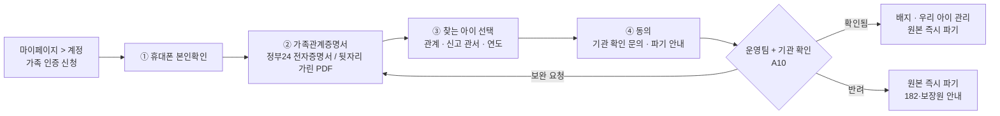

# FindUs 가족 인증 · 펀딩 관리 · 경찰청 협력 검토

> 작성일: 2026.10.22
> 기준 문서: `[03] 펀딩_계획_화면흐름.md`, `[02] 사용자플로우_메뉴구조.md`
> 표기: **[가정]** = 팀 결정 전 임시 값 · **[결정 필요]** = 팀 회의 안건 · **[미확인]** = 조사했지만 공식 근거를 찾지 못함
> ⚠ 법률 해석은 전문가 자문 전 검토 메모입니다. 조문은 국가법령정보센터 원문으로 다시 확인해 주세요.

---

## 0. 한 줄 요약

**부모가 "등록된 실종아동의 가족"임을 한 번에 증명하는 공식 증명서는 찾지 못했다. 그래서 가족 인증은 ① 본인확인 → ② 관계 증명(가족관계증명서) → ③ 기관 확인(아동권리보장원·경찰)의 3단계로 하고, 서류는 확인에만 쓰고 파기한다. ③은 기관과 협력해야만 할 수 있다.**

함께 정한 것: 아이를 내건 펀딩의 수익은 **찾기 목적에만** 쓰고 FindUs 운영비로 쓰지 않는다. (실종아동법 제15조)

---

## 1. 조사 결과

### 1-1. 실종아동등의 보호 및 지원에 관한 법률

| 조항 | 내용 | 우리에게 뜻하는 것 |
|---|---|---|
| 제2조 (정의) | **보호자** = 친권자, 후견인, 그 밖에 법률에 따라 아동을 보호·부양할 의무가 있는 사람 (시설장·종사자 제외). 아동등 = 실종 당시 18세 미만 아동, 지적·자폐성·정신장애인, 치매환자 | 가족 인증 대상은 "부모"가 아니라 **보호자**로 정의한다 (어머니·아버지·법정 후견인·그 밖의 보호자) |
| 제9조의3 | 경찰청장은 **보호자의 동의**를 받아 사업자에게 공개수색을 요청할 수 있고, 정보는 "발견과 복귀에 필요한 최소한"이어야 한다 | 아이 정보 공개는 보호자 동의가 전제다. 캠페인마다 **가족 승인**을 받는다 |
| 제11·12조 | 유전자 검사대상물 채취는 서면 동의가 필요하다. 찾기 목적 외로 채취·검사·이용하거나 누설하면 처벌한다 | **DNA·유전정보는 어떤 경우에도 받지 않는다** |
| **제15조** | "누구든지 정당한 사유 없이 실종아동등의 신상정보를 실종아동등을 찾기 위한 목적 외의 용도로 이용할 수 없다." 위반하면 2년 이하 징역 또는 2천만 원 이하 벌금(제18조) | 아이 이름·사진을 내건 펀딩 수익이 운영비로 가면 목적 외 이용으로 볼 위험이 있다 → **수익을 찾기 목적에만 쓴다**(4장) |
| 제5조 | 복지부 업무(홍보, DB, 가족 지원 등)는 아동권리보장원 등에 위탁할 수 있다 | 가족 확인과 기부처는 **아동권리보장원 실종아동전문센터**를 1순위 협력 기관으로 본다 |

- 출처: https://casenote.kr/법령/실종아동등의_보호_및_지원에_관한_법률 (시행 2026.5.12 수록본)
- 제3자가 실종아동 관련 모금이나 캠페인을 하는 것을 직접 규율하는 조항은 **찾지 못했다**. 제15조로 판단해야 한다.

### 1-2. 개인정보 보호법

- **주민등록번호**는 법령에 근거가 있어야만 처리할 수 있다(제24조의2). 우리에게는 근거가 없으므로 **받지 않는다**. 서류는 뒷자리를 가린 채 발급하게 하거나 가린 사본만 받는다.
- 국민권익위원회도 신분증 사본에서 주민번호 전체를 요구하지 말고 가리는 양식으로 바꾸라고 의견을 낸 적이 있다. https://www.metroseoul.co.kr/article/20260730500323
- **최소 수집과 파기**: 확인 목적을 이루면 원본을 파기하고 "누가, 언제, 어떤 기관을 통해 확인했는지"만 남긴다.

### 1-3. 관계를 증명하는 방법

| 방법 | 내용 | 비고 |
|---|---|---|
| 가족관계증명서 (특정증명서) | 표시할 항목을 고를 수 있다(가족관계등록예규 제561호). 정부24에서 발급할 때 주민번호 뒷자리 비공개를 선택할 수 있다 | https://korea.legal/wiki/가족관계등록예규-제561호/ |
| 정부24 전자증명서 | 가족관계증명서 등 22종을 2021년부터 제공한다. 진본 확인이 되고 민간에도 제출할 수 있다 | https://www.fnnews.com/news/202111120938076698 · 민간이 **제출처로 등록하는 절차는 [미확인]** |
| 휴대폰 본인확인 (PASS 등) | 이름·생년월일·연계정보(CI)를 받는다 | 사칭과 중복 계정을 막는다 |
| "실종 신고 사실 확인서" | **공식 발급 절차를 찾지 못함 [미확인]** | 182, 관할 경찰서 여성청소년과, 아동권리보장원(02-777-0182)에 문의해야 한다 |

### 1-4. 기부금품법

- 기부금품은 "반대급부 없이" 받는 금품이다(제2조). 1천만 원 이상을 모집하려면 등록해야 하고(제4조), 등록하지 않으면 3년 이하 징역 또는 3천만 원 이하 벌금이다. https://www.nepla.ai/law/기부금품의-모집-및-사용에-관한-법률
- 리워드형은 판매 계약으로 보는 견해가 있다. 하지만 **굿즈 가격이 시가보다 크게 높으면 기부로 볼 위험**이 있다. 행정안전부 유권해석은 찾지 못했다 **[미확인]**.
- → 등록청(시·도, 행안부)에 사전 질의한다 **[결정 필요]**.

### 1-5. 경찰청·기관 협력 사례

| 사례 | 내용 |
|---|---|
| 경찰청 × 당근마켓 (2025.9) | 안전Dream 정보를 실시간 공유하고, **발견되면 게시글을 자동 삭제**한다. https://mobile.newsis.com/view/NISX20250922_0003339031 |
| 토스 × 대전경찰청 | 실종 경보를 단말기 화면에 표시한다. https://toss.im/tossfeed/article/50621 |
| 아동권리보장원 기업 홍보 | CU, 죠리퐁, 한전 고지서, 넥슨 등. https://www.kukinews.com/article/view/kuk202112230067 |
| 공공데이터포털 | 실종 관련 API (15153224, 이용허락 "제한 없음"). https://data.go.kr/catalog/15153224/openapi.json |

- 구조: **경찰이 보호자 동의를 받아 안전Dream에 공개하고, 협력사는 공개된 정보를 받아 쓴다.**
- **협력사가 직접 가족을 인증한 사례나, 경찰이 협력사를 위해 가족관계를 확인해 주는 제도는 찾지 못했다 [미확인].** 그래서 3장의 협력 제안이 필요하다.

---

## 2. 가족 인증 설계 (프론트 목업 구현 완료)

### 2-1. 흐름

### 2-2. 받는 정보 / 남기는 정보

| 구분 | 내용 |
|---|---|
| 받는 것 | 본인확인 결과(이름·생년월일·CI), 가족관계증명서(특정, 뒷자리 비공개), 아이 관리번호, 관계, 신고 관서·연도(선택) |
| **남기는 것** | 아이 관리번호, 관계, 확인한 기관, 확인일, 본인확인 CI 해시 |
| **남기지 않는 것** | 가족관계증명서 원본(확인 후 바로, 늦어도 30일 안에 파기), 주민번호(받지 않음), DNA·유전정보(받지 않음), 아이의 추가 사진·신상(받지 않음) |

### 2-3. 상태와 규칙

| 상태 | 화면 | 다음 |
|---|---|---|
| 기관 확인 중 | "보통 5~10일(영업일)" **[가정]** | 확인됨 / 보완 요청 / 반려 |
| 보완 요청 | 사유와 [다시 제출] | 기관 확인 중 / 반려 |
| 확인됨 | 하트+체크 배지 "가족 확인됨", 원본 파기일, 재확인일 | (1년 뒤) 기관 확인 중 |
| 반려 | 사유, 182·보장원 연락처 | — |

- 재확인 주기: **1년** **[가정]**
- 아이가 발견돼 공개가 종료되면 배지와 캠페인을 즉시 내린다.
- 가족은 언제든 해지할 수 있다. 해지하면 기록과 캠페인 승인이 모두 지워진다.

### 2-4. 인증 가족이 할 수 있는 것

1. **배지**: 마이페이지 프로필, 관심 아동 카드, 펀딩 목록·상세("가족이 함께해요")
2. **캠페인 승인·보류**와 **가족의 한마디**(300자): 펀딩 상세의 이야기 위에 인용 블록으로 표시한다
3. **우선 처리 요청**: 정보 정정 요청, 비공개 요청(즉시 공개 중지 → 목록에서 빠지고 상세는 "공개를 잠시 멈췄어요")
4. **하지 않는 것**: 가족이 펀딩을 직접 여는 기능. 기부금품법과 정산 책임 때문이다

### 2-5. 프론트 구현 위치 (목업)

| 파일 | 역할 |
|---|---|
| `lib/familyVerification.ts` | 단계 검사, 상태 전환, 원본 파기 처리, 캠페인 가족 승인 (localStorage 목업) |
| `app/mypage/verify` · `components/FamilyVerifyFlow.tsx` | 4단계 신청 화면 |
| `components/AccountSettings.tsx` | 마이페이지 > 계정: 회원 정보·배송지·가족 인증·우리 아이 관리 |
| `components/FamilyBadge.tsx` | 하트+체크 배지 |

- 개발 환경에서는 계정 탭에 **"데모: 심사 결과 바꾸기"**가 보인다. 배포 환경에서는 숨긴다.
- **실제 서비스로 가려면**: 백엔드 인증, 본인확인기관 계약, 서류 암호화 저장소, 자동 파기 스케줄러, 관리자 화면 A10이 필요하다.

---

## 3. 경찰청 · 아동권리보장원 협력 제안서 (초안)

### 3-1. 대상과 창구

| 기관 | 창구 | 이유 |
|---|---|---|
| 아동권리보장원 실종아동전문센터 | 02-777-0182 | 가족 지원, 홍보 위탁 기관(법 제5조). 가족 확인과 기부처의 1순위 |
| 경찰청 여성청소년안전기획과 (안전Dream 운영) | 182 | 공개 정보·사진 이용, 발견 시 삭제 연동 |
| 관할 경찰서 여성청소년과 | 사건별 | 개별 가족 확인 |

### 3-2. 요청 항목

1. **가족 확인 회신 절차**: 보호자 동의를 전제로, FindUs가 "관리번호 + 신청인 이름 + 관계"를 보내면 보호자가 맞는지 회신받는 절차
2. **안전Dream 데이터와 사진의 이용 범위**: 펀딩 페이지와 굿즈 QR 연결 화면에서 써도 되는 항목
3. **AI 나이 변환 이미지의 게시 기준과 표기**: 정부 사업(복합인지기술)과 헷갈리지 않게 하는 표기
4. **발견 시 삭제 연동**: 당근마켓 협약처럼 공개가 종료되면 자동으로 내린다
5. **제보 창구 일원화**: FindUs는 제보를 받지 않고 182로만 안내한다(현재 원칙 유지)
6. **기부처 지정**: 캠페인 수익의 "가족 지원 기부" 몫을 받을 곳

### 3-3. 미리 물어볼 것

- [ ] "실종 신고 사실 확인서" 같은 문서를 보호자가 발급받을 수 있는가?
- [ ] 정부24 전자증명서의 제출처로 민간 서비스를 등록하는 절차는? (행안부)
- [ ] 아이 이름·사진을 내건 리워드 펀딩이 제15조의 "찾기 목적"에 해당하려면 어떤 조건이 필요한가?
- [ ] 리워드형 펀딩이 기부금품 모집에 해당하는가? (시·도 / 행안부)

### 3-4. 우리가 약속할 것

- 서류 미보관, 주민번호와 DNA 미수집
- 수익을 찾기 목적에만 쓰고, 영수증까지 공개
- 발견되면 즉시 내림
- 굿즈에 아이 얼굴을 넣지 않음

---

## 4. 펀딩 수익 구조 변경 (프론트 반영 완료)

`[03]` 1-6의 "순익 절반 기부 후 운영비"를 다음처럼 바꾼다. **아이가 등장하는 캠페인에는 운영비를 넣지 않는다.**

| 갈래 | 비율 **[가정]** | 내용 |
|---|---|---|
| 굿즈 제작·배송 | 60% | 제작, 포장, 배송, 결제 수수료 |
| {아이 이름}님 찾기 홍보 | 25% | QR 포스터 추가 인쇄, 실종 지역 옥외·온라인 광고 |
| 실종아동 가족 지원 기부 | 15% | 기부처 결정 전 (예: 아동권리보장원) |

- 펀딩 상세 "모인 돈은 {이름}님을 찾는 데에만 써요": 리워드를 고르면 원 단위로 나눠 보여주고, 막대와 카드가 애니메이션으로 나뉜다 (`components/funding/FundsFlow.tsx`)
- 약속: 영수증 공개, 발견 시 남은 홍보비는 가족 동의를 받아 다른 장기 실종아동 홍보에 사용
- **FindUs 운영비는 기업 후원(`[03]` 1-7)과 아이가 등장하지 않는 일반 캠페인으로 마련한다** → 수익 시나리오(`[03]` 1-6)를 다시 계산해야 한다 **[결정 필요]**

---

## 5. 펀딩 관리 (관리자) 화면 설계

`[03]` 3-2의 A01~A09에 더한다. 구현은 백엔드 인증과 `role` 준비 뒤에 한다.

| ID | 화면 | 주요 기능 |
|---|---|---|
| **A10** | 가족 인증 심사 | 신청 목록(상태·대기일) → 서류 열람(열람 기록 남김) → 기관 확인 요청 기록(기관·요청일·회신) → 결과(확인/보완/반려 + 사유) → **원본 파기 체크**(30일 기한 알림) |
| **A11** | 캠페인 가족 승인 현황 | 캠페인별 가족 승인·보류, 가족의 한마디 검수, 비공개 요청 처리(환불 여부 연락), 발견 시 내림 |
| A04 (보완) | 후원 내역 | 가족 비공개 요청으로 멈춘 캠페인의 후원자 일괄 안내 |
| A07 (보완) | 정산·결과 공개 | 4장의 세 갈래 기준으로 사용 내역과 영수증 공개 |

- **권한**: `role: "admin"`(전체), `role: "reviewer"`(A10만). 서류 열람과 결과 변경은 **두 명이 확인**한다.
- **기록**: 누가, 언제, 무엇을 열람하고 바꿨는지 남긴다. 기록 보관 기간은 **[결정 필요]**.

---

## 6. 배송지 저장 (프론트 반영 완료)

- 마이페이지 > 계정 > 배송지 관리: **최대 5개**, 기본 배송지 1개, 카카오 우편번호 서비스로 검색
- 후원할 때:
  - 기본 배송지 요약 카드가 자동으로 나온다. [배송지 변경]과 [이번만 수정](저장된 주소는 그대로)을 쓸 수 있다.
  - 처음 후원할 때는 "이 배송지 저장하기"를 고를 수 있다(선택).
- 주소록은 **회원이 저장을 고른 계정 정보**다. 후원 건마다 배송 후 파기하는 배송 정보와는 따로 관리한다. 서버로 옮길 때는 암호화해서 저장한다.

## 7. 보류한 아이디어

**수량 지정 + 여러 곳으로 나눠 보내기 (홍보용 배포)**: 같은 세트를 여러 개 후원해 가족·지인에게 나눠 보내는 아이디어다. QR 노출이 늘어나 취지에 맞지만 보류한다.

- 추가 배송비: 배송지 1곳당 3,500원 **[가정]**
- 제3자(받는 분) 주소 입력 동의
- 한정 수량(패밀리 50개) 재고 차감, 개수만큼 사이즈 선택
- `[03]` 1-3의 "한 번에 한 단계만" 원칙과의 관계

---

## 8. 팀 결정 필요

1. 수익 배분 비율 (60 / 25 / 15)과 기부처
2. 운영비를 어디서 충당할지 (기업 후원, 아이 없는 일반 캠페인) → 수익 시나리오 재계산
3. 가족 인증 재확인 주기 (1년?)와 심사 기간 안내 문구
4. 기부금품법 사전 질의 (시·도 / 행안부)와 법률 자문 일정
5. 협력 제안을 보낼 순서 (아동권리보장원 먼저 vs 경찰청 먼저)
6. 사업자 주체, 본인확인기관과 PG 계약 명의
