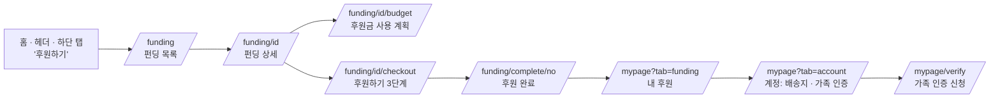
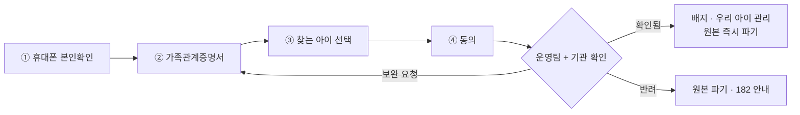

# `feature/funding` 브랜치 구현 정리

> 작성일: 2026.10.22 · 기준 브랜치: `dev`
> 기획 문서: `[03] 펀딩_계획_화면흐름` · `[04] 가족인증_펀딩관리_경찰협력` · `[05] 기업 실종아동 캠페인 사례`
> 표기: **[목업]** = 브라우저 localStorage에만 저장되고 서버·결제는 없음 · **[가정]** = 팀 결정 전 임시 값

---

## 0. 한눈에 보기

| 기능 | 한 줄 설명 | 상태 |
|---|---|---|
| 💳 **리워드 펀딩** | 금액별 QR 굿즈 세트를 골라 FindUs에서 직접 후원 (목록 → 상세 → 결제 → 완료) | 화면 완성 · [목업] |
| 💰 **후원금 사용 계획** | 어느 협력사가 얼마에 무엇을 만드는지, 남은 돈이 어디로 가는지 공개 | 화면 완성 · 단가·기업 [가정] |
| 🤝 **협력 기업(제안 대상)** | `[05]` 사례를 근거로 고른 기업 11곳. **협약 전이라 개발 환경에서만 보임** | 데이터 [가정] |
| 👪 **가족 인증** | 실종아동 가족 확인 4단계 신청 + 배지 + 캠페인 승인 | 화면 완성 · [목업] |
| 📦 **배송지 관리** | 주소록 최대 5개, 후원할 때 기본 배송지 자동 입력 | 화면 완성 · [목업] |
| 🙋 **마이페이지 확장** | "내 후원", "계정" 탭 추가 | 화면 완성 |

- 이 브랜치는 **아직 커밋 전**이다. 결제(PG)·백엔드 API는 붙어 있지 않다.
- `npm run lint` · `npm run typecheck` · `npm test` 통과 (테스트 110개).

---

## 1. 화면 지도

| 주소 | 화면 | 주요 파일 |
|---|---|---|
| `/funding` | 펀딩 목록 | `app/funding/page.tsx` · `components/funding/FundingList.tsx` |
| `/funding/[id]` | 펀딩 상세 | `app/funding/[id]/page.tsx` · `components/funding/FundingDetail.tsx` |
| `/funding/[id]/budget` | 후원금 사용 계획 **(이번에 추가)** | `app/funding/[id]/budget/page.tsx` · `components/funding/BudgetDetail.tsx` |
| `/funding/[id]/checkout` | 후원하기 (리워드 → 정보 입력 → 확인·결제) | `components/funding/CheckoutFlow.tsx` |
| `/funding/complete/[no]` | 후원 완료 | `components/funding/PledgeComplete.tsx` |
| `/mypage?tab=funding` | 내 후원 (조회 · 취소 · 키링 디자인 선택) | `components/funding/MyPledges.tsx` |
| `/mypage?tab=account` | 계정 (회원 정보 · 배송지 · 가족 인증) | `components/AccountSettings.tsx` |
| `/mypage/verify` | 가족 인증 신청 4단계 | `components/FamilyVerifyFlow.tsx` |

---

## 2. 리워드 펀딩

### 2-1. 규칙

| 항목 | 내용 |
|---|---|
| 목표 | **300만 원**. 못 넘으면 전액 환불 |
| 리워드 | 응원 5,000 · QR 키링 15,000 · 에코백 29,000 · 티셔츠 49,000 · 후드 89,000 · 패밀리 149,000(한정 50개) |
| 스트레치 골 | 500만 키링 디자인 2종 · 1,000만 키링 세트에 에코백 · 2,000만 엽서·스티커팩 · 3,000만 실종아동의 날 캠페인 |
| 굿즈 원칙 | 아이 얼굴은 넣지 않고 **QR만** 넣는다. QR은 최신 장기 실종아동 목록으로 연결 |
| 상태 | 오픈 예정 → 진행 중 → 마감 임박(3일 이내) → 성공 / 종료 |

### 2-2. 상세 화면 구성

`이야기` → `굿즈(금액별 진화)` → `스트레치 골` → `왜 QR만 넣나요 + 모인 돈이 가는 길` → `일정·환불 정책` → `후원자 벽` (+ 오른쪽 리워드 선택)

- **이야기**: 최준원님은 책자 기반 긴 이야기(`lib/fundingStory.ts`), 나머지는 경찰청 공개 정보로 대신한다.
- **가족의 한마디**: 인증된 가족이 남긴 글이 이야기 위에 인용으로 나온다.
- **아이 정보 옆에는 리워드·기업 정보를 두지 않는다.**

### 2-3. 캠페인 데이터

| id | 아이 | 공개 여부 |
|---|---|---|
| `choi-junwon` | 최준원 | 공개 (가족·권리자 동의 전제) [가정] |
| `yoon-jihyun` · `yoo-junho` · `jo-haneul` | 예시 | **개발 환경에서만** (`example: true`) |

### 2-4. 직접 확인하기 (개발 환경)

- 상태별 화면: `/funding/choi-junwon?state=upcoming|closing|success|failed`
- 후원은 이 브라우저 localStorage(`findus:pledges`)에 저장된다. 지우면 처음 상태로 돌아간다.

---

## 3. 후원금 사용 계획 ⭐ 이번 작업

### 3-1. 바꾼 것: 고정 비율 → 실제 원가 먼저

| | 이전 | 지금 |
|---|---|---|
| 계산 | 모든 리워드를 굿즈 60 / 홍보 25 / 기부 15로 고정 | **굿즈·배송·수수료를 원가대로 먼저 빼고**, 남은 돈을 홍보 5 : 기부 3 |
| 티셔츠 세트 49,000원 | 굿즈 29,400 · 홍보 12,250 · 기부 7,350 | 굿즈 **21,363** · 홍보 **17,274** · 기부 **10,363** |
| 문제점 | 마감 후 영수증과 금액이 맞지 않음 | 영수증 공개와 그대로 맞출 수 있음 |

> 티셔츠 세트 원가 = 키링 1,500 + 에코백 2,530 + 티셔츠 12,000 + 택배 3,500 + 결제 수수료 1,833 (3.4% + 부가세)

- 스트레치 골 보너스(에코백 추가, 엽서·스티커팩)도 원가에 자동으로 더한다.
- 리워드 없이 더 낸 **추가 후원금**은 굿즈 없이 수수료만 빼고 홍보·기부로 간다.
- FindUs **운영비는 넣지 않는다** (실종아동법 제15조, 운영비는 기업 후원으로 마련).

### 3-2. `/funding/[id]/budget` 페이지 구성

| 구역 | 보여주는 것 |
|---|---|
| **공개 단계** | `예상 · 견적 기준`(펀딩 중) → `확정 · 발주`(마감 후) → `집행 · 영수증`(배송 후) |
| **이번 회차 전체 예산** | 모인 금액 · 후원자 · 배송 상자 수, 굿즈/홍보/기부 막대, **돈이 가는 곳(협력사별 금액)**, 품목별 수량·단가·합계 표 |
| **내 후원금 영수증** | 리워드를 고르면 1인 후원금을 원 단위로 나눠 보여줌 |
| **함께하는 곳** | 역할별 협력 기업 카드 (맡을 일 · 고른 이유 · 출처 링크 · 이번 회차 예상 금액) |
| **한 번만 드는 돈** | 고정비 약 100만 원, 키링 금형 약 30만 원 → 회차 스폰서가 부담 |
| **사용 내역** | 마감 후 공개 예정 (날짜·항목·거래처·금액·영수증) |

들어오는 길: 펀딩 상세 "모인 돈이 가는 길" 아래 **[어디서 만들고 어떻게 쓰는지 자세히 보기]**

### 3-3. 최준원님 회차 예시 (예시 모금액 7,440,000원 기준)

| 돈이 가는 곳 | 맡는 곳 | 내용 | 금액 |
|---|---|---|---|
| 만드는 곳 | 블랙야크강태선나눔재단 | 티셔츠 53장 · 후드 27벌 | 1,500,000원 |
| 만드는 곳 | 업체 선정 중 | 키링 세트 199개 · 에코백 120개 | 602,100원 |
| 보내는 곳 | 한진 | 택배 185상자 | 647,500원 |
| 결제 | 토스 | 결제 수수료 3.74% | 278,256원 |
| 최준원님 찾기 홍보 | CU · 당근 | 매체별 금액은 협약 후 확정 | 2,757,590원 |
| 가족 지원 기부 | 아동권리보장원 · 초록우산 중 1곳 | 전액 기부 | 1,654,554원 |
| **합계** | | | **7,440,000원** |

### 3-4. 협력 기업 (모두 **협약 전 · 제안 대상**)

| 역할 | 기업 | 맡길 일 | 고른 근거 (`[05]`) |
|---|---|---|---|
| 만드는 곳 | 블랙야크강태선나눔재단 | 후드·티셔츠 제작 / 원단 후원 | 배낭 홍보택, 2026 복지부 장관 표창 |
| 보내는 곳 | 한진 | 택배 + 호프테이프 | 호프테이프 누적 약 93만 개, 경찰청장 감사장 |
| 보내는 곳 | 우정사업본부 | 대체 운송사 | 호프테이프 공동 시작 |
| 결제·정산 | 토스 | PG 수수료 감면 | 결제 단말기 실종경보 |
| 결제·정산 | NH농협은행 | 모금 전용 계좌, 내역 공개 | 이체 화면 실종아동 정보, 장관 표창 |
| 찾기 홍보 | BGF리테일(CU) | 실종 지역 결제단말기 송출 | 단말기로 20년 만의 상봉, 아이CU 200명 귀가 |
| 찾기 홍보 | 당근 | 동네생활 지역 타깃 | 안전Dream 실종 정보 공유 |
| 기부처 후보 | 아동권리보장원 · 초록우산 | 가족 지원 기부 | 장기 실종아동 캠페인 이력 |
| 회차 스폰서 | KB국민은행 · 티르티르 | 고정비·운영비 | 경찰청장 감사장 / 택배 상자 QR 라벨 |

> ⚠ **협약 전 기업 이름은 배포 화면에 나오지 않는다.** `listedPartners()`가 배포 환경에서는 `status: "signed"`인 곳만 돌려준다.
> 협약을 맺으면 `lib/fundingBudget.ts`의 `PARTNERS`에서 해당 기업의 `status`를 `"signed"`로 바꾸면 된다.
> 키링·에코백 제작사는 `[05]`에 근거가 없어 **"업체 선정 중"**으로 둔다 (지어낸 회사명 없음).
> **로고**: 각 기관 공식 사이트에서 받아 `public/images/partners/`에 두고, 출처는 같은 폴더 `sources.json`에 적었다 (아동권리보장원은 기존 `images/agencies/ncrc.png`). 협약 때 기업 브랜드 가이드에 맞는 파일로 바꾼다.

### 3-5. 값 바꾸는 곳

| 바꿀 것 | 파일 · 위치 |
|---|---|
| 품목 단가, 맡는 기업 | `lib/fundingBudget.ts` → `UNIT_COSTS` |
| 결제 수수료율 | `lib/fundingBudget.ts` → `PAYMENT_FEE_RATE` |
| 협력 기업 정보 · 협약 상태 | `lib/fundingBudget.ts` → `PARTNERS` |
| 홍보 : 기부 비율 | `lib/funding.ts` → `FUNDS_PLAN`의 `share` |
| 고정비 | `lib/fundingBudget.ts` → `FIXED_COSTS` |

---

## 4. 가족 인증

| 항목 | 내용 |
|---|---|
| 남기는 것 | 아이 관리번호, 관계, 확인 기관, 확인일, 본인확인 CI 해시 |
| **받지 않는 것** | 주민번호 전체, DNA·유전정보, 아이 추가 사진 |
| 인증 후 할 수 있는 것 | 가족 배지, 캠페인 승인·보류, 가족의 한마디(300자), 정보 정정·비공개 요청 |
| 하지 않는 것 | 가족이 펀딩을 직접 여는 기능 (기부금품법·정산 책임) |
| 데모 | 개발 환경 계정 탭의 **"데모: 심사 결과 바꾸기"**로 확인됨/보완/반려를 바꿔 본다 |

파일: `lib/familyVerification.ts` · `components/FamilyVerifyFlow.tsx` · `components/FamilyBadge.tsx` · `lib/useFamily.ts`

---

## 5. 배송지 관리

- 마이페이지 > 계정 > 배송지: **최대 5개**, 기본 배송지 1개, 카카오 우편번호 검색
- 후원할 때 기본 배송지가 자동으로 채워지고 **[배송지 변경]** · **[이번만 수정]**을 쓸 수 있다.
- 주소록(회원이 저장한 정보)과 후원 건별 배송 정보(배송 후 파기)는 따로 관리한다.

파일: `lib/addressBook.ts` · `lib/useAddressBook.ts` · `components/AddressBook.tsx` · `components/AddressSearchButton.tsx`

---

## 6. 기존 화면에서 바뀐 것

| 파일 | 변경 |
|---|---|
| `components/Header.tsx` | 텀블벅 외부 링크 "후원하기" 버튼 제거, `/funding`에서 상단 유틸 바 숨김 |
| `components/HeaderNav.tsx` · `MobileBottomNav.tsx` | 메뉴에 **후원하기**(`/funding`) 추가 |
| `components/HomeLanding.tsx` | 후원 카드: "프로젝트 준비 중 · 텀블벅" → **"펀딩 진행 중 · 펀딩 보러 가기"** |
| `components/MyPage.tsx` · `app/mypage/page.tsx` | **내 후원 · 계정** 탭 추가, `?tab=`으로 탭 열기, 닉네임 옆 가족 배지 |
| `components/FavoriteChildren.tsx` | 가족 확인된 아이는 "내 아이" 대신 가족 배지 |
| `components/AccountButton.tsx` | **삭제** (계정 탭으로 옮김) |
| `components/Icons.tsx` | 아이콘 추가 |

---

## 7. 데이터는 어디에 있나 (모두 [목업])

| 데이터 | 지금 | 백엔드로 바꿀 때 |
|---|---|---|
| 캠페인 · 리워드 · 스트레치 골 | `lib/funding.ts` 상수 | API 응답으로 교체, 계산 함수는 그대로 |
| 후원 내역 | localStorage `findus:pledges` (`lib/fundingStore.ts`) | 저장소 함수 내부만 fetch로 교체 + PG 결제 |
| 단가 · 협력 기업 | `lib/fundingBudget.ts` 상수 | 관리자 입력(A07 정산)으로 교체 |
| 가족 인증 | localStorage (`lib/familyVerification.ts`) | 서버 + 본인확인기관 + 관리자 심사(A10) |
| 주소록 | localStorage (`lib/addressBook.ts`) | 서버에 암호화 저장 |

> 데이터 접근은 위 파일 한 곳에만 모아 두었다. **화면 코드는 고치지 않고 저장소 함수만 바꾸면 된다.**

---

## 8. 테스트

| 파일 | 확인하는 것 |
|---|---|
| `lib/funding.test.ts` (20) | 달성률, 기간·상태, 리워드·보너스, 입력 검사 |
| `lib/fundingBudget.test.ts` (12) | 원가 계산, 합계 = 후원금, 보너스 원가, 회차 전체 수량, 협약 전 기업 숨김 |
| `lib/familyVerification.test.ts` (7) | 단계 검사, 상태 전환, 원본 파기 |
| `lib/addressBook.test.ts` (8) | 최대 5개, 기본 배송지 |

---

## 9. 남은 일 · 팀 결정 필요

**결정 필요**
1. 홍보 : 기부 비율 (지금 5 : 3)과 기부처 한 곳
2. 고정비를 회차 스폰서가 낼지, 협약 전이면 원가에 넣을지
3. **부가세**: 리워드 펀딩은 재화 판매라 과세 가능성이 크다 (49,000원 중 약 4,455원). 세무 확인 후 원가에 반영
4. 협력 기업에 제안할 순서와, 제안 단계에서 이름을 써도 되는지 동의
5. 가족 인증 재확인 주기 (1년?)

**구현 남음**
- PG 결제 연동, 펀딩 백엔드 API
- 관리자 화면: A06 배송, A07 정산·사용 내역 입력, A10 가족 인증 심사, A11 가족 승인 현황
- 사용 내역(영수증) 원장 화면 — 지금은 "마감 후 공개" 안내만
- 포장재·박스 견적 반영 (지금은 택배비 3,500원에 포함)
- `[04]` 4장의 고정 비율(60/25/15) 설명을 이 문서 3-1 기준으로 고치기
