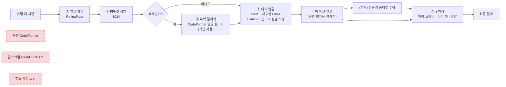

> 2026-10-20 작성. 최종 모델(`configs/final.yaml`, 화면 `/final`)이 **왜 지금 모양이 되었는지** 한 곳에 모았다.
무엇을 비교했고, 무엇을 넣고 무엇을 뺐는지, 그 근거 숫자가 어디서 나왔는지를 적는다.
숫자는 모두 기존 실험 기록([02], [13]~[16], [23], [26])에서 가져왔고, 출처 폴더(`experiments/...`)를 함께 적었다. 새로 돌린 실험은 없다.
용어: **dev** = 설정을 고를 때 쓴 데이터(67명), **test** = 마지막에 한 번만 쓴 확인용 데이터(77명). **ArcFace·AdaFace** = 두 얼굴이 같은 사람인지 점수(코사인 유사도)를 매기는 얼굴인식 모델.
> 

---

## 0. 한눈에 보기

### 0-1. 최종 모델 흐름

빨간 점선 상자는 **실험해 보고 뺀 것**이다.

### 0-2. 단계별 결론

| 단계 | 최종 모델에서 | 비교한 것 | 고른 이유 (한 줄) |
| --- | --- | --- | --- |
| 얼굴 검출 | **RetinaFace** | FAN, dlib, SCRFD (연결만) | C++ 빌드 없이 연결되고 5점 랜드마크로 바로 FFHQ 정렬 가능 (후보끼리 정확도 비교는 하지 않음) |
| 복원 (전처리) | **끔** | CodeFormer 켬/끔 | 켜면 신원 점수가 떨어지거나 같음 (3장) |
| 업스케일 (전처리) | **끔** | Real-ESRGAN 켬/끔 | 켜면 신원 점수가 떨어짐 (3장) |
| 흑백 컬러화 | **CodeFormer 얼굴 컬러화** (흑백일 때만) | DDColor 4종, CodeFormer, 부모 피부색 맞추기 | 신원 유지 1위, 눈으로 가장 자연스러움 (4장) |
| 나이 변환 본체 | **SAM** | FADING(디퓨전), LATS, CUSP | 대안 모두 6GB·아이 입력·한국인 조건에서 SAM 보다 나을 근거가 없음 (5장) |
| 나이 변환 보정 | **3-C 재구성 LoRA + 3-A v3 latent 어댑터 → ???** | 학습 없는 섞기, 3-A v1·v2, 대조 손실, 3-C v1·v2, 3-B | test 에서 원본 SAM 대비 +0.05, 77명 중 79% 개선 (5장) |
| 성별 보정 | **세기 2** | 세기 0·1·2·3·5 | 성별 뒤바뀜 37% → 24%, 닮은 정도도 오름 (5장) |
| 부모 사진 | **사실상 안 씀** (넣을 수는 있음) | 진짜 부모 / 부모 없음 / 남의 부모 | 네 가지 방법 모두 효과 0 (6장) |
| 머리 스타일 (후처리) | **HairFastGAN** + 얼굴 지키기 합성 | HairCLIP(v2), Stable-Hair, HairFusion | 같은 StyleGAN 1024 계열, MIT, 6GB 에서 실행 확인 (7장) |
| 머리 색 (후처리) | **머리 영역 Lab 칠하기** (직접 만듦) | HairFastGAN 색 참조 | 원하는 색을 정확히 (ΔE 0.1~0.4) (7장) |
| 화장 (후처리) | **EleGANt** (기본), CSD-MT (선택) | BeautyGAN, CSD-MT, 디퓨전 계열 | 신원 유지가 가장 높고 깨끗함 (7장) |
| 평가 | **ArcFace · AdaFace** | 학습용 IR-SE50 과 분리 | 학습이 평가 점수를 속이지 못하게 (8장) |

---

## 1. 출발점: 왜 원본 그대로 쓰지 않았나

처음에는 공개 모델을 그대로 이어 붙였다: **검출 → 정렬 → 복원 → 나이 변환(SAM)** ([01]).
그런데 결과를 재 보니 **나이 변환이 오히려 손해**였다.

| AI Hub 에이징 검증 20쌍 (`experiments/val20_default/`) | ArcFace |
| --- | --- |
| 어릴 때 사진 그대로 (변환 없음) ↔ 실제 성인 | 0.257 |
| 원본 SAM 결과 ↔ 실제 성인 | **0.129** |

그래서 "신원이 어디서 사라지는가"부터 쟀다 (`experiments/diag_dev/`, dev 67명).

| 단계 | 잃는 양 (ArcFace) |
| --- | --- |
| 인버전 (사진 → StyleGAN latent 로 옮기기) | **−0.40** |
| 나이 변환 (latent 를 목표 나이로 옮기기) | −0.19 |

→ 이 두 결과가 이후 모든 선택의 기준이 됐다.

1. **"같은 사람으로 보이는가"를 깎는 단계는 뺀다** (→ 복원·업스케일 제거, 3장).
2. **신원을 잃는 곳(인버전·나이 변환)을 작은 모듈로 보정한다** (→ LoRA·어댑터, 5장).

---

## 2. 모델을 고르는 공통 기준

| 기준 | 이유 |
| --- | --- |
| **신원 유지가 1순위** | 실종아동 검색 용도라 "예쁜 사진"보다 "같은 사람으로 알아볼 수 있는가"가 중요 |
| 공개 가중치 | 직접 큰 모델을 학습할 자원이 없음 |
| 6GB GPU (RTX 1000 Ada), Windows | 실제 개발·시연 환경. 단계마다 모델을 올렸다 내림(`keep_loaded: false`) |
| 1024 FFHQ 정렬과 맞음 | SAM·HairFastGAN 모두 같은 정렬 얼굴을 씀 |
| 연구용 라이선스 | 학교 연구 과제 |
| dev 로 고르고 test 는 한 번만 | 고르는 과정에서 test 를 쓰면 점수가 부풀려짐 |

---

## 3. 전처리(복원·업스케일)는 왜 뺐나

### 3-1. 처음에 넣었던 이유

- 실종아동의 어릴 때 사진은 대부분 오래된 필름·스캔본이라 흐리고 잡음이 있다.
- SAM 은 깨끗한 얼굴(FFHQ)로 학습됐으니, 흐린 입력을 깨끗하게 만들어 주면 나을 것이라고 생각했다.
- 그래서 **CodeFormer(복원, w=0.7)** 와 **Real-ESRGAN(업스케일, 얼굴이 작을 때)** 를 넣었다 ([01] 3장, [23] 1~3장).

### 3-2. 실험해 보니 신원이 깎였다

**best11** (아이 사진 11장 × 나이 10~50세, `experiments/best11_compare/`)

| 설정 | 입력 신원 유지 | 실제 그 나이 사진과 유사도 | 동일인 판정률 |
| --- | --- | --- | --- |
| **복원 X / 업스케일 X** | **0.454** | **0.242** | **37%** |
| 복원 X / 업스케일 O | 0.423 | 0.236 | 32% |
| 복원 O / 업스케일 X | 0.402 | 0.211 | 26% |
| 복원 O / 업스케일 O | 0.373 | 0.200 | 26% |
- 켤수록 모든 점수가 떨어졌다. 깨끗하게 **다시 그리는** 과정에서 그 사람만의 특징이 지워지고 "평균적인 깨끗한 얼굴"에 가까워지는 것으로 본다.
- 11장(9명)뿐이라 경향만 봤다.

**dev 67명 확인** (복원 켬 `kin_eval_v3_dev` ↔ 복원 끔 `kin_eval_final_dev`, 같은 사람끼리 짝지어 비교)

|  | 복원 켬 | 복원 끔 |
| --- | --- | --- |
| 최종 모델 ArcFace | 0.2174 | **0.2248** |
| 최종 모델 AdaFace | 0.2094 | **0.2110** |
| 최종 모델 Top-1 (ArcFace) | 37.3% | **40.3%** |
- 차이 ArcFace +0.007 (p=0.14), AdaFace +0.002 (p=0.75). 통계적으로 유의하지는 않다.
- 하지만 **꺼도 손해가 없고**, CodeFormer 를 올리지 않아 더 빠르다.
- 보정 모듈(LoRA·어댑터)은 복원된 얼굴로 학습됐는데도 복원을 꺼서 손해가 없었다는 점이 중요하다.

### 3-3. 결론과 남은 점

- **최종 모델에서 복원·업스케일을 모두 끈다** (`restorer: none`, `pre_upscale`/`post_upscale: none`).
- 업스케일은 best11 에서만 비교했고 dev 에서 따로 재지는 않았다.
- 학습 캐시가 복원된 얼굴로 만들어져 있어 학습·추론 입력이 다르다. 재학습할 때 캐시도 복원 없이 다시 만든다 ([13] 1단계).
- CodeFormer 를 고른 이유(충실도 w 로 신원 쪽 조절 가능)와 다른 복원 후보(GFPGAN·RestoreFormer·GPEN)를 직접 비교하지 않은 점은 [23] 에 적어 두었다.
- 전처리 중 **흑백 컬러화는 남겼다.** 흑백일 때만 돌고, 얼굴 모양은 바꾸지 않기 때문이다 (4장).

---

## 4. 흑백 컬러화: 무엇을 비교했고 무엇을 넣었나

- 입력 아이 사진 중 흑백·세피아는 약 3.5~4% (Validation 1,328장 중 46장 자동 판단, [11]). 적지만 옛날 사진일수록 많다.
- 정렬 얼굴의 '색 퍼짐'이 3.0 미만일 때만 컬러화하고, 컬러 사진은 그대로 통과한다 (`when: auto`, `gray_threshold: 3.0`).

### 4-1. 비교 (dev 컬러 아이 사진 67명을 흑백으로 바꿔 다시 색 입히기, `experiments/colorize_compare_dev/`)

| 후보 | 피부색 차이 ΔE (작을수록 좋음) | 신원 유지 | 나이 변환 점수 | VRAM |
| --- | --- | --- | --- | --- |
| 원래 컬러 (상한) | 0 | 1.000 | 0.1934 |  |
| 흑백 그대로 (하한) | 14.83 | 0.965 | 0.1890 |  |
| DDColor modelscope | 8.29 | 0.958 | 0.1914 | 1.73GB |
| DDColor artistic | **7.84** | 0.969 | **0.1935** | 1.73GB |
| DDColor paper | 8.43 | 0.957 | 0.1900 | 1.73GB |
| DDColor paper_tiny | 8.33 | 0.955 | 0.1914 | 1.06GB |
| **CodeFormer 얼굴 컬러화 (채택)** | 8.46 | **0.972** | 0.1929 | **0.78GB** |
| artistic + 부모 피부색 맞추기 | 8.39 | 0.966 | 0.1942 |  |
- 2026-10 기준 DDColor 보다 확실히 나은 "자동 + 공개 가중치 + 6GB" 모델은 찾지 못해서 위 후보끼리 비교했다 ([15] 1장).
- **부모 피부색 맞추기는 뺐다.** 부모와 자녀 피부색이 실제로 달라서 ΔE 가 오히려 커졌다 (7.84 → 8.39).

### 4-2. CodeFormer 를 고른 이유 (2026-10-19 변경)

- 처음에는 숫자(ΔE·나이 변환 점수) 1위인 DDColor artistic 을 골랐다.
- `/colorize` 화면에서 직접 비교해 보니 CodeFormer 결과가 **눈으로 더 자연스러웠고**, **신원 유지가 가장 높았다** (0.972).
- 숫자 차이는 작다: ΔE 0.62, 나이 변환 점수 0.0006. 흑백 그대로와 컬러화의 차이(0.005)보다도 작다.
- 모델 안에서 복원도 일어나지만, **색(a·b)만 쓰고 밝기(L)는 원본**을 쓰므로 얼굴 모양·화질은 바뀌지 않는다. 그래서 3장의 "복원 끔" 결론과 충돌하지 않는다.
- 한계: 진짜 옛날 흑백 사진은 정답 색이 없어 이 방법으로 잴 수 없다. 기본 설정(`default.yaml`)은 아직 DDColor artistic 이다.

---

## 5. 나이 변환: 무엇을 비교했고 무엇을 넣었나

### 5-1. 본체: SAM 을 유지한 이유

다른 공개 나이 변환 모델을 문서·논문 수치로 검토했다 (설치·실행은 하지 않음).

| 후보 | 판단 | 근거 |
| --- | --- | --- |
| **FADING** (디퓨전, BMVC 2023) | 쓰지 않음 | 아이 → 30세를 시키면 평균 45.8세로 너무 늙게 만듦(SAM 18.2세), 신원 보존 순위는 논문마다 반대, 동양인 결과 없음, 6GB 에서 장당 약 10~20분(추정)·학습 불가 ([18]) |
| **LATS** (ECCV 2020) | 비교군으로만 | Windows 실행은 되지만 20대 목표를 학습하지 않음, 나이 오차 25.5세(SAM 5.3세), 옛날 필름·흑백 비권장 ([19]) |
| **CUSP** (ECCV 2022) | 쓰지 않음 | 실제 사진용 실행 코드가 고장 보고된 Colab 뿐, 아이 입력 불확실, Windows CUDA 컴파일 문제 ([19]) |
| **SAM** (2021) | **채택** | 아이 입력 가능, 숫자 나이 지정, 6GB 에서 1초 미만, 작은 모듈을 붙여 학습할 수 있음 |

→ 본체를 바꾸기보다 **SAM 위에 작은 보정 모듈을 학습**하는 방향을 택했다.

### 5-2. 보정 모듈: 시도한 것 전부

SAM 본체(인코더·StyleGAN2)는 고정하고 작은 모듈만 학습했다. 데이터는 AI Hub 528 가족 데이터의 train(가족 단위 분할).

| # | 방법 | 결과 | 판정 |
| --- | --- | --- | --- |
| 0 | 학습 없는 부모 섞기 (부모 latent 를 층별로 섞기) | SAM 대비 +0.002 | 효과 없음 |
| 1 | 3-A v1 latent 어댑터 (전 18층) | 학습용 망(IR-SE50) 점수만 크게 오름. 평가용 ArcFace 는 +0.02, 얼굴이 하얗게 뜨고 입술이 자주색 | 실패 ("학습용 망 속이기") |
| 2 | 3-A + 대조 손실 | train 가족만 외움 | 중단 |
| 3 | 3-A v2 (0~7층만, 정규화 10배) | ArcFace 로는 SAM 주변 | 효과 없음 |
| 4 | 3-C v1·v2 재구성 인코더 LoRA | 손실을 바꿔도 나아지지 않음 | 실패 |
| — | **원인 발견**: 메모리를 아끼려고 쓴 기울기 근사가 진짜 기울기와 방향이 많이 달랐음 (코사인 0.55) | bf16·batch 1 이면 진짜 역전파도 2.9GB → 진짜 기울기로 교체 |  |
| 5 | **3-C v3 재구성 LoRA** (진짜 기울기) | 재구성 0.670 → 0.699, 학습용·평가용 점수가 처음으로 함께 오름 | **채택** |
| 6 | **3-A v3 latent 어댑터** (3-C 인코더 위에서) | dev SAM 대비 ArcFace +0.050, AdaFace +0.053, 얼굴 자연스러움 | **채택** |
| 7 | 3-B 나이 인코더 조건부 LoRA | 3-A v3 와 같은 수준 (차이 p=0.6~0.9) | 탈락 (더 무겁고 이득 없음) |
- 3-A v3 와 3-B 의 성능이 같아서 **더 단순하고 가벼운 3-A v3** 를 골랐다 ([02] 4-9).
- 효과의 대부분은 3-A 어댑터에서 나온다. 3-C LoRA 는 재구성은 고쳤지만 나이 변환 결과까지는 거의 바꾸지 못했다 (SAM 결과 0.170 → 0.168, [13] 3장).

### 5-3. test 최종 1회 (`experiments/kin_eval_v3_test/`, `kin_eval_sam_test/`, 77명)

| 조건 | ArcFace | AdaFace | Top-1 (ArcFace) |
| --- | --- | --- | --- |
| 변환 없음 (어릴 때 사진 그대로) | **0.346** | **0.355** | **84%** |
| 원본 SAM | 0.204 | 0.178 | 43% |
| **최종 모델** (3-C + 3-A v3) | **0.256** | **0.239** | 31% |
- 원본 SAM 대비 **ArcFace +0.052, AdaFace +0.061 (p<1e-9), 77명 중 79% 개선.** dev 결과가 그대로 재현됐다.
- 같은 사람 중복을 빼고(실제 52명) 다시 재도 +0.055 (p=4e-9) 로 유지된다.

### 5-4. 성별 보정 (학습 없음, `src/gender.py`)

- 최종 모델 결과의 **37%가 반대 성별로 판정**됐다 (실제 성인 사진은 4.5%). 결과가 "성인 평균 얼굴"로 몰리는 문제가 성별에서도 나타난 것이다.
- train 성인 사진 latent 로 "성별 방향"을 구하고(dev 정확도 97.7%), 고른 성별 경계 밖으로 벗어난 결과만 경계 쪽으로 밀어 준다.

| 세기 (dev 67명) | 성별 뒤바뀜 | 실제 성인과 닮은 정도 (ArcFace) | 보정 전 결과와 유사도 |
| --- | --- | --- | --- |
| 보정 없음 | 37.3% | 0.195 | 1.000 |
| 1 | 29.9% | 0.204 | 0.980 |
| **2 (채택)** | **23.9%** | **0.207** | 0.950 |
| 3 | 22.4% | 0.208 | 0.919 |
| 5 | 26.9% | 0.203 | 0.856 |
- 세기 2 와 3 의 효과가 비슷해서, 얼굴이 덜 바뀌는 **2** 를 골랐다 (`gender_strength: 2.0`). 0.195 → 0.207 은 p=0.0007 ([16]).
- 성별은 사용자가 화면에서 고른다 (자동 추정 아님). test 확인은 아직 하지 않았다.

---

## 6. 가족 데이터(부모 사진)는 왜 쓸모없었나

> 정확히 말하면 **"가족 데이터 전체"가 아니라 "부모 사진"이 쓸모없었다.**
AI Hub 528 가족 데이터의 **어릴 때 사진 ↔ 본인 성인 사진** 쌍은 보정 모듈 학습에 그대로 쓰였고, +0.05 개선도 여기서 나왔다.
> 

### 6-1. 처음 가설

"아이 얼굴만으로는 커서 얼굴형을 알기 어렵다 → 부모 사진을 조건으로 넣으면 더 정확해진다" ([01] 1장).

### 6-2. 확인 방법: 부모 입력만 바꿔 비교

| 조건 | test ArcFace | test AdaFace |
| --- | --- | --- |
| 진짜 부모 | 0.256 | 0.239 |
| 부모 없이 | **0.259** | **0.242** |
| 남의 부모 (다른 가족) | 0.259 | 0.243 |
- 부모 효과가 있다면 "진짜 부모"가 가장 높아야 한다. 실제로는 **오히려 조금 낮고**, 차이는 우연 범위다 (중복 제거 52명 기준 ArcFace −0.004, p=0.15).
- 결과 사진 자체도 거의 같다: 진짜 부모 ↔ 부모 없이 결과끼리 유사도 **0.968**, 픽셀 차이 4.4/255 (보정 모듈이 바꾸는 양 27.2 의 약 1/6).
- 네 가지 방법(학습 없는 섞기, 3-A, 3-A + 대조 손실, 3-B)에서 **모두 효과 0** 이었다 ([14] 3장).

### 6-3. 왜 효과가 없었나

| 원인 | 근거 |
| --- | --- |
| **부모 얼굴에 자녀의 성인 얼굴 정보가 적다** (가장 근본적) | 실제 성인 사진과의 유사도: 아이 자신의 어릴 때 사진 **0.346** vs 부모 사진 **0.171**. 얼굴인식 입장에서 부모는 "조금 닮은 남" |
| **부모 둘 다 있는 세트가 드물다** | train 1,498세트 중 둘 다 있는 세트 **49개(3.7%)**. 한 명만 있으면 그 부모의 성별·나이 특징이 섞여 들어옴 |
| **학습 손실이 부모를 쓸 이유를 주지 않는다** | 손실은 "정답 성인 사진과 닮아라" 하나뿐. 모든 결과를 성인 평균 얼굴로 옮기는 게 가장 쉬운 길이라 모델이 그쪽을 택함 |
| **학습 인원이 적다** | 같은 사람이 친가·외가 번호로 두 번 등록되어 있어 실제 인원은 train 115 · dev 44 · test 52명. 가족 유사성 같은 약한 신호를 배우기에 부족 |
| 착시 주의 | 결과 ↔ 부모 유사도가 0.029 → 0.060 으로 올라 부모가 반영된 것처럼 보이지만, **부모 없이도 0.061**. 결과가 평균 얼굴로 몰려 모든 성인과 조금씩 닮아진 것뿐 |

### 6-4. 그래서 최종 모델에서는

- 모델 구조(3-A 어댑터)에는 부모 조건 입력이 남아 있지만, **결과에 영향이 없다.** `/final` 화면에서 부모 사진은 선택 칸이고 "결과가 거의 바뀌지 않는다"고 적어 두었다.
- 보고서·발표에서는 "부모 사진으로 정확도를 높였다"고 주장하지 않는다. **"개선은 보정 모듈 덕분이고, 부모 효과는 검증되지 않았다"** 고 쓴다.
- 다시 시도한다면: 중복 정리 후 부모 둘 다 있는 세트만으로 측정 → 0~6세 출발 그룹에 집중 → 기울기 버그를 고친 상태로 대조 손실 재시도 ([14] 6장).

---

## 7. 후처리는 왜 넣었나

### 7-1. 넣은 이유

- **나이 변환은 얼굴의 나이만 바꾼다.** 머리 모양은 어릴 때 사진을 거의 따라간다. 아기 사진처럼 머리가 짧은 입력은 결과도 머리가 아주 짧다 ([15] 6-2).
- 하지만 실제로 자란 사람은 머리 모양·색, 화장이 어릴 때와 전혀 다르다. 검색·전단용 얼굴로는 **"이런 머리였다면" 여러 버전**을 보여 주는 것이 쓸모 있다.
- 운영 흐름도 이를 전제로 짰다: **나이 변환 → (전문가 몽타주 수정) → 요청받은 머리·화장 적용** ([04], [17]).

### 7-2. 설계 원칙: 신원 점수를 건드리지 않게

| 원칙 | 이유 |
| --- | --- |
| 나이 변환 **밖에서**, 결과 사진에만 적용 | 나이 변환 모델을 바꿔도 그대로 동작. 실패해도 나이 변환 결과는 남음 (`/api/final/run` 과 `/api/final/hair`·`/makeup` 분리) |
| **신원 평가는 후처리 전 결과로** | 머리·화장은 꾸밈이지 신원 변화가 아님. 5장의 test 숫자는 후처리 전 값 |
| 얼굴은 최대한 원본 유지 | 머리 모델이 사진 전체를 다시 그려도 얼굴 부위는 원래 것을 씀 (얼굴 지키기 합성) |
| 단계로 쌓기 | 머리 → 화장 → 머리처럼 이어서 적용하고, 원하는 단계로 돌아갈 수 있음 ([15] 6장) |

### 7-3. 머리 스타일: HairFastGAN

| 후보 | 판단 | 이유 ([04] 3장) |
| --- | --- | --- |
| **HairFastGAN** (NeurIPS 2024) | **채택** | SAM 과 같은 StyleGAN FFHQ 1024 계열이라 결과를 그대로 입력, MIT 라이선스, 머리 모양·색 참조를 따로 지정 |
| HairCLIP / v2 | 제외 | 텍스트 입력은 장점이지만 v2 는 최적화 기반이라 느림 |
| Stable-Hair (디퓨전) | 2순위 | 모델이 여러 개라 6GB 에서 빠듯할 가능성 |
| HairFusion (디퓨전) | 제외 | VAE 만 약 4GB, 라이선스 확인 불가 |
- 우리 PC(6GB, Windows)에서 실제로 돌려 확인했다: 1장 13~26초, 입력 대비 ArcFace 0.62~0.85 ([04]).
- 그대로 쓰면 생긴 문제와 보완:

| 문제 | 보완 | 결과 |
| --- | --- | --- |
| 사진 전체를 다시 그려 얼굴이 바뀜 | **얼굴 지키기 합성**: 얼굴 분할로 얼굴 부위는 입력, 머리·배경만 HairFast 결과 | ArcFace **0.776 → 0.940** |
| 참조와 얼굴 크기가 안 맞음 | 얼굴 폭이 비슷한 참조 자동 고르기 | 비율 오차 0.069 → 0.044 ([02] 4-11) |
| 배경이 어둡거나 흐린 참조에서 머리가 부풂 | 참조 품질 6가지 지표로 60장 → 24장 선정, 참조 배경 지우기 | 일그러짐 사라짐 ([21]) |
| 짧은 머리를 입힐 때 원래 앞머리 잔머리가 남음 | 넣기 전에 원래 머리 지우기, 이마·눈썹 채우기 (`clear_hair`, 기본 켬) | 잔머리 사라짐, 대신 ArcFace 0.07~0.11 하락 ([22]) |
| 외국인 예시 참조뿐 | AI Hub 에이징 데이터에서 한국인 머리 사진을 자동 분류해 8종 × 3장 등록 | [04] |

### 7-4. 머리 색: 직접 만든 Lab 칠하기 (`src/hair_color.py`)

- HairFastGAN 은 색도 **참조 사진**으로만 받아서 "애쉬 브라운" 같은 원하는 색을 정확히 낼 수 없다.
- 얼굴 분할(BiSeNet)로 머리 영역을 구하고, 원래 명암(결·윤기)은 남긴 채 평균 색만 목표 색으로 옮긴다.
- 목표 색과 차이 **ΔE 0.1~0.4** (2 이하면 사람 눈으로 구분 불가), 1장 1초 안쪽, 생성 모델을 올리지 않는다 ([15] 4장).

### 7-5. 화장: EleGANt (기본), CSD-MT (선택)

| 후보 | 판단 | 이유 ([24], [26]) |
| --- | --- | --- |
| BeautyGAN (2018) | 제외 | 공식 코드 없음(비공식 TF1.9, 라이선스 없음), 256 에서 얼굴 전체를 다시 그려 신원·주름이 깎임 |
| 디퓨전 계열 (Stable-Makeup, SHMT 등) | 제외 | 눈·코·입 모양까지 참조 쪽으로 바꾼다는 보고가 여러 논문에 있음 → 신원 우선인 과제와 맞지 않음 |
| CSD-MT (CVPR 2024) | 선택지로 남김 | 화장이 또렷함. 같은 사람 점수 세기 0.5 에서 0.917 |
| **EleGANt** (ECCV 2022) | **기본** | 화장이 깨끗하고 부위별 편집 가능. 같은 사람 점수 세기 0.5 에서 **0.941** |
- 두 모델 모두 256 해상도라 그대로 쓰면 흐려진다. 그래서 **256 결과의 색 차이만 1024 사진에 부위별 세기로 더한다** (`src/makeup_transfer.py`).
- 처음엔 참조의 하얀 피부 톤까지 옮겨져 신원이 크게 떨어졌다 → 피부 톤 이동을 따로 떼어 기본 0 으로 막았다.
- 측정 (Validation 여성 8명 × 참조 3장, ArcFace 화장 전 대비): 세기 0.3 / 0.5 / 1.0 에서 EleGANt **0.970 / 0.941 / 0.864**, CSD-MT 0.958 / 0.917 / 0.816. 0.3~0.4초, GPU 최대 456MB.
- 그래서 화면의 세기는 최대 0.8, 여성 0.4 / 남성 0(끔)으로 시작한다.
- 한계: 학습 데이터가 젊은 동아시아 여성 위주라 남성·중장년 품질은 보장되지 않는다. 라이선스는 둘 다 비상업 연구용(CC BY-NC-SA 4.0).

### 7-6. 아직 넣지 않은 것

- 피부 보정, 안경: 계획만 있다 ([20] 2장). 안경은 눈 분할을 막아서 맨 마지막에 넣을 예정이다.

---

## 8. 평가 방식도 모델 구성의 일부다

- **학습 손실에는 IR-SE50, 평가에는 ArcFace·AdaFace** 를 쓴다. 3-A v1 처럼 학습용 망 점수만 오르고 실제로는 부자연스러운 얼굴이 나오는 "속임수"를 이렇게 잡아냈다 ([05] 10-13).
- 데이터는 **가족 단위**로 나눴다 (형제·부모가 train 과 test 에 섞이지 않게).
- 모든 설정(복원 끔, 컬러화 모델, 성별 보정 세기, 체크포인트)은 dev 에서 골랐고, test 는 최종 모델에 한 번만 썼다.

---

## 9. 최종 모델의 한계 (솔직하게)

| 한계 | 숫자 |
| --- | --- |
| **변환하지 않은 어릴 때 사진을 아직 못 이긴다** | test 최종 0.256 vs 변환 없음 0.346 |
| 검색(Top-1)은 원본 SAM 보다 낮다 | 43% → 31% (ArcFace). 평균 점수는 오르지만 결과끼리 비슷해짐 (결과끼리 유사도 0.41, 실제 성인끼리 0.08) |
| 진짜 병목인 인버전은 거의 그대로 | 인버전 손실 0.397 → 0.382 |
| 나이가 제대로 바뀌었는지 확인이 어렵다 | 나이 추정기 오차가 실제 사진에서도 11.5세 |
| 데이터 중복 | 실제 인원 train 115 · dev 44 · test 52명, dev·test 2명 겹침 |
| 라이선스 | CodeFormer, insightface, dlib 68점, CSD-MT·EleGANt 는 비상업·연구용 |

다음 할 일(중복 제거 재분할, 복원 없는 캐시로 재학습, 대조 손실, 평가 지표를 margin·Top-1 로)은 [13] 5장에 있다.